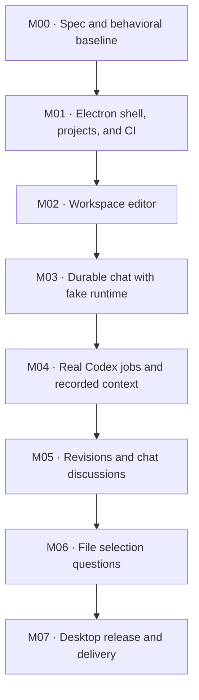

# ResOS desktop implementation roadmap

The [spec](SPEC.md) owns requirements and acceptance criteria. This roadmap
sets their order. Each milestone closes with its checks and a short verification
record. See [verification](VERIFICATION.md) for M01 and M02.
M03 is the next implementation milestone.

| Milestone | Requirement IDs | Exit gate |
| --- | --- | --- |
| M00 · Spec | — | Desktop requirements, prototype references, dependency graph, and working agreements are recorded. |
| M01 · Foundation | DESK-01, PROJ-01 | Initialize the fresh repository. Run a strict TypeScript Electron window, use the real folder picker, add two temporary projects, restart, and see both again. Build a Linux package in CI and smoke-test the packaged application. |
| M02 · IDE | IDE-01, IDE-02 | Edit files from two projects and pass stale-save, unsaved-buffer, and workspace-confinement checks. Exercise the desktop editor by keyboard. |
| M03 · Durable chat | PROJ-02, CHAT-01 | Decide prototype import scope and record the storage choice. Use two temporary projects and a fake streaming runtime to verify persistence, folder relocation, and job isolation across UI switches. |
| M04 · Codex | JOB-01, JOB-02, CTX-01 | Run deterministic tests for queueing, permissions, restart, retry, and context isolation. Verify one real Codex turn locally and record the CLI version. Ancestry tests gain branch and attachment fixtures in M05 and M06. |
| M05 · Chat passages | CHAT-02, CHAT-03, CHAT-04 | Verify repeated selections, formula selection, historical revisions, nested navigation, and correct context after a revision or retry. |
| M06 · File excerpts | FILE-01, FILE-02 | Ask about an unsaved selection, then edit or remove the file. Reopen the chat and verify the original excerpt and its use in a later turn. |
| M07 · Release | REL-01 | Test install and launch on a clean supported Linux desktop. Restore a sample backup. If import is in scope, migrate a copy of prototype data and verify IDs, revisions, and links. Produce the versioned package and checksum. |

## CI and delivery

- In M01, pin the build runtime and dependencies. Document one local check
  command that CI also runs for formatting, linting, typechecking, unit tests,
  integration tests as they land, and build. Exercise Electron under a virtual
  display in CI with temporary application data. Check the native folder picker
  and application-menu entry on a desktop.
- Package the Linux artifact in CI from M01. In M07, add a manually triggered
  release workflow for an explicit version or tag. Rebuild from that revision,
  rerun the checks, and produce a versioned package and checksum. Publishing
  is an explicit release step. Automatic desktop updates are outside v1.
- Keep real Codex smoke tests local and opt-in. The default suite uses fixtures
  and a fake adapter and requires no account credentials.

## Milestone working loop

Start with the milestone's requirements and write its acceptance checks
alongside the change. Keep pull requests within one milestone, update affected
docs with the implementation, and record the commands and manual checks that
passed. Record consequential design choices in `docs/decisions/` as they
are made. M01 records build, packaging, and supported Linux targets.
